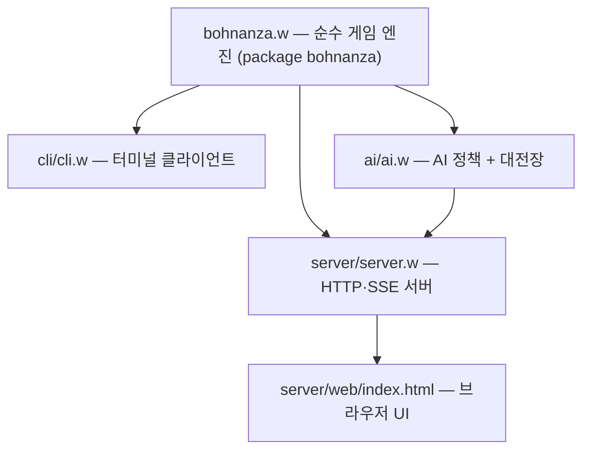

# 🫘 보난자 (Bohnanza)

콩 농사 보드게임 **보난자**를 웹앱으로 옮긴 것이다. 규칙만 아는 순수 게임
엔진을 바탕에 두고, 그 위에 터미널 클라이언트·AI 봇·HTTP 서버·브라우저 UI를
얹었다. 백엔드 전체는 한글 **GWEB**(Go WEB 문학적 프로그래밍)으로 쓰였다.

핵심 설계는 **책임의 분리**다. 규칙은 오직 엔진이 안다. 나머지 계층은 엔진에서
한 플레이어의 *가려진 뷰*를 받아 그리고, 고른 *액션*을 돌려보낼 뿐이다. 그래서
CLI든 봇이든 웹이든 모두 **똑같은 계약**을 쓰고, 남의 손패나 덱 속은 그 경계
밖으로 새지 않는다.

## 특징

- **순수·결정론 엔진** — I/O도 전역 상태도 없다. 씨앗을 주입한 `math/rand/v2`
  PCG로, 같은 씨앗과 같은 수순은 언제나 같은 게임이 된다.
- **불변식으로 지키는 규칙** — 코인을 정수가 아니라 카드 더미로 쥐어, 게임
  어디서든 카드가 정확히 154장이라는 *카드 보존* 불변식을 검사한다(변형에서
  뺀 콩도 상자 대신 `Removed`에 두어 154장이 유지된다). 2~4인 수천 판 무작위
  완주 시험이 상태 기계의 구멍을 훑는다.
- **공식 인원별 변형** — 2인 *콩 결투*는 거래 없이 제안 더미와 버림패 낚기로
  도는 별개의 턴 구조다. 3인은 카카오콩을 빼고 전원이 한 장씩 보충한다.
- **플레이어 뷰 가림** — 서버는 `State`를 쥐고 바깥으로는 `View`만 내보낸다.
  남의 손패는 장수만, 덱 속은 총장수만 보인다.
- **AI 봇** — 어림짐작으로 두는 그리디 봇. *거래하는* 봇과 *거래만 뺀* 봇을
  맞붙여 "거래가 실력을 얼마나 끌어올리는가"를 숫자로 잰다.
- **실시간 웹** — 표준 라이브러리(`net/http`)만으로 SSE 밀어내기 + POST.
  방 코드·자리별 토큰 인증, 새로고침 후 이어 하기, 자유형 다장 거래 빌더,
  참가자 이름, 거래 흥정용 채팅까지.
- **문학적 프로그래밍** — 코드가 곧 읽는 문서다. 모든 백엔드는 `.w` 하나가
  Go 소스와 조판된 PDF를 함께 낳는다.

## 구조



| 파일 | 내용 | tangle 산출 |
| --- | --- | --- |
| `engine/engine.w` | 순수 게임 엔진 | `engine/engine.go`, `engine/engine_test.go` |
| `cli/cli.w` | 핫시트·봇 대전 터미널 | `cli/cli.go` |
| `ai/ai.w` | 봇 정책과 대전장 | `ai/ai.go`, `ai/ai_test.go` |
| `server/server.w` | 게임 서버 | `server/server.go` |
| `server/web/index.html` | 자체 완결형 웹 UI(정적) | — |
| `types.w` | 문서들이 공유하는 조판 힌트 | — |

`.w` 파일은 `@i types.w`로 공유 힌트를 끌어 쓴다. 웹 UI만은 문학적 문서가
아니라 평범한 정적 파일이며, 앞단의 nginx가 직접 내보낸다(게임 서버는 API에만
집중한다).

## 요구 도구

- **Go 1.26 이상** — 이것만 있으면 clone 후 바로 빌드된다. tangle 산출물
  (`*.go`)을 저장소에 함께 두어, 받는 쪽엔 GWEB이 필요 없다.
- **GWEB**(`gtangle`, `gweave`) — `.w`를 **고칠 때만** 필요하다. `.w`를
  Go 소스와 TeX로 바꾼다. 고쳤다면 `make tangle`로 `.go`를 다시 낳는다.
- (문서 PDF를 뽑을 때만) **LuaTeX**와 `kotexgweb`

## 빌드와 실행

`make`가 tangle과 실행을 엮는다.

| 명령 | 하는 일 |
| --- | --- |
| `make` | tangle + 문서 조판 |
| `make tangle` | `.w` → `.go` |
| `make test` | `go test ./...` (엔진·봇 시험) |
| `make arena` | 봇 실력 측정(`go test -v ./ai`) |
| `make cli ARGS="3 1 42"` | CLI 실행(인원·사람수·씨앗) |
| `make server ARGS=":8080"` | 서버 실행(주소) |
| `make doc` | PDF 조판(한글이라 LuaTeX) |
| `make clean` | 생성물 삭제(`.w` 원본은 남김) |

### 터미널에서 봇과 대결

```sh
make cli ARGS="3 1 42"   # 3명(사람 1 + 봇 2), 씨앗 42
```

사람은 낮은 자리(0번부터), 봇은 높은 자리를 맡는다. 사람수를 `0`으로 주면
봇들끼리 두는 것을 구경할 수 있다.

### 웹으로 플레이

웹 UI는 앞단 nginx가 내보내므로, 브라우저 플레이는 아래 [Docker로 띄우기](#docker로-띄우기)로
실행한다. `make server`는 정적 파일 없이 게임 API만 여는 순수 서버다(curl·테스트용).

`docker compose up --build` 뒤 `http://localhost:8080`에 접속한 뒤:

1. **이름**·**인원**·**봇 수**(선택)·**씨앗**(선택)을 정해 *새 게임 만들기*.
   방 코드가 생긴다.
2. 친구에게 방 코드를 알려 주면, 같은 화면에서 *참가*로 방에 들어온다.
3. 합법수는 버튼으로 나오고, 자유형 거래는 *거래 만들기*로 여러 장을 골라
   제안한다. 옆의 **채팅**으로 흥정하고, **콩미터 표**로 몇 장에 몇 코인인지
   확인한다.
4. 콩은 **날아서** 자리를 옮긴다 — 손패에서 밭으로, 덱에서 공개 자리로, 거래하면
   두 사람 사이로. 거둔 밭은 번쩍이며 코인이 떠오른다. 봇의 0.5초 뜸과 맞물려
   무슨 일이 있었는지 눈으로 좇을 수 있다. 운영체제에서 *동작 줄이기*를 켜 두었다면
   아무것도 움직이지 않는다(`prefers-reduced-motion`).
5. 머리글의 **🔇 소리**를 누르면 소리가 켜진다(기본은 꺼짐, 설정은 저장된다).
   소리 파일은 없다 — 짧은 음을 그 자리에서 합성하므로 페이지는 여전히 바깥
   자원을 하나도 안 쓴다. 가장 쓸모 있는 것은 **당신 차례** 알림이다. 봇이
   0.5초씩 뜸을 들여 한 바퀴가 여러 초이니, 눈을 떼도 알 수 있다. 거래 제안은
   *나에게 온 것만* 울린다.
6. 자리를 쓰지 않고 구경만 하려면 *관전*. 방이 가득 차 있어도, 판이 한창이어도
   붙을 수 있고, 몇 명이든 들어온다. **관전자에게는 아무의 손패도 보이지 않는다** —
   밭·코인·손패 장수·공개 카드 같은 공개 정보만 본다(그래야 관전자가 플레이어에게
   패를 흘릴 수 없다). 채팅은 되며 이름 옆에 👁이 붙는다.

## Docker로 띄우기

**nginx**를 앞에 세워 정적 파일(웹 UI·향후 이미지)을 직접 내보내고, 동적
API(SSE·액션·채팅 등)만 뒤의 **Go 서버**로 넘긴다. 호스트 **8080** 포트로
서비스한다.

```sh
docker compose up --build
```

접속: `http://localhost:8080`

- **nginx** — 8080을 열고 `server/web`를 정적 루트로 서빙한다. 정적 파일이
  있으면 직접 내고 없으면 앱으로 넘기므로(`try_files … @app`), API 길이
  늘어도 설정을 손볼 필요가 없다. SSE 스트림만 버퍼링을 꺼 실시간 밀어내기를
  지킨다.
- **app** — Go 서버(컨테이너 안 8080, 호스트에 열지 않음). tangle된 `.go`를
  그대로 빌드하므로 이미지 안에서 GWEB이 필요 없다.

이미지 같은 정적 파일을 더할 때는 `server/web/` 아래에 두면 nginx가 바로 낸다.
`.w`를 고쳤다면 `make tangle`로 `.go`를 갱신한 뒤 다시 빌드한다.

## 서버 API

토큰은 URL에 싣지 않는다. 액션·뷰는 `Authorization: Bearer <토큰>` 머리글로,
스트림은 쿠키(`bz_token`)로 신원을 확인한다(SSE의 `EventSource`가 머리글을 못
실어서다).

| 메서드·경로 | 하는 일 |
| --- | --- |
| `POST /games?players=&bots=&seed=` | 새 게임 → 방 코드 |
| `POST /games/{code}/join?name=` | 빈자리 잡기 → 자리 번호 + 토큰 |
| `POST /games/{code}/watch?name=` | 자리 없이 관전 → 토큰 (자리 번호 `-1`) |
| `GET /stream` | 내 뷰를 SSE로 구독 |
| `POST /action` | 액션(JSON)을 보냄 |
| `POST /chat` | 방에 채팅 한 줄 보냄 |
| `GET /view` | 내 뷰를 한 번 받음 |
| `GET /catalog` | 콩 도감(이름·장수·콩미터) |

## 봇은 얼마나 잘 두는가

`make arena`가 봇을 수백 판 맞붙여 승률과 평균 점수를 매긴다. 정책은 넷이다 —
`Random`(밑바닥), `Greedy`(v2, 거래함), `Cautious`(v2에서 거래만 뺌),
`Strategist`(v3, 거래를 값어치로 잼).

측정이 봇을 한 판 더 끌고 갔다. **v2는 거래로 점수는 올렸지만 승률은 못 올렸다** —
평균 점수는 비거래 봇을 앞서는데(2.06 대 1.75) 승률은 공정 몫 25%를 못 넘었다.
거래가 *양의 합*이라 내가 넘긴 콩이 받는 쪽도 살찌워, 절대 점수만 다 같이 오르고
*차이*는 남지 않았기 때문이다.

**v3은 그 차이를 겨냥한다.** 콩미터로 "이 콩 한 알이 저 사람에게 코인 몇 개어치인가"를
재서, ① 가장 덜 이롭게 하는 상대에게 넘기고 ② 선두를 도우면 두 배로 깎고
③ 밑지는 거래는 아예 안 한다. v2 봇들 사이에 홀로 앉혔을 때(같은 자리의 v2를 기준선으로):

| | v2 기준선 | v3 | |
| --- | --- | --- | --- |
| 3인 승률 | 29.3% | **44.8%** | +15.5pp |
| 4인 승률 | 19.8% | **29.8%** | +10.0pp |
| 3인 점수차 | −0.05 | **+1.32** | |

봇은 수와 수 사이에 **0.5초씩 뜸을 들인다**(`botPause`). 예전에는 봇 서넛의
수십 수가 한 묶음으로 쏟아져 판이 순간이동하는 것처럼 보였다. 서버는 봇을 따로
도는 고루틴으로 굴리는데, **방 뮤텍스를 쥔 채로는 절대 자지 않는다** — 그랬다간
채팅도 참가도 막히고 청소부가 허브 잠금을 쥔 채 멎는다. `go test -race ./server`가
그 불변식을 지킨다. 봇끼리만 두는 CLI 판(`cli 3 0 42`)은 읽을 사람이 없으니
뜸 없이 곧장 끝난다.

v3은 **절대 점수가 오히려 낮으면서**(9.0 대 9.6) 상대와의 차이를 벌려 이긴다.
그 대가도 있다: v3끼리만 두면 서로 밑지는 거래를 마다해 판 전체 점수가 폭삭
내려앉는다(3인에서 모두 v2면 9.7점, 모두 v3이면 4.4점 — 거래를 아예 안 하는
봇의 3.9점에 가깝다). *세다*는 것과 *재미있다*는 것은 다른 말이라, 시험이 그
구분을 숫자로 남겨 둔다. CLI와 서버는 v3을 앉힌다.

## 게임 규칙 (요약)

- 콩은 **11종 154장**(흔한 커피콩 24장부터 귀한 카카오콩 4장까지). 각 콩은
  *콩미터*라는 환전표를 가진다: 같은 콩을 몇 장 거두면 코인 몇 개가 되는지.
- **손패는 순서를 바꿀 수 없다.** 늘 맨 앞에서부터 꺼내 심는다.
- **한 밭에는 한 종류의 콩만.** 이 두 제약이 "원치 않는 콩을 남에게 넘기는"
  거래를 게임의 심장으로 만든다.
- 한 턴은 **심기 → 거래 → 받은 콩 심기 → 보충**으로 흐른다. 거래 단계에서
  덱 두 장을 공개하고, 활성 플레이어가 상대와 교환을 흥정한다.
- 덱이 바닥나면 게임이 끝난다. 밭을 모두 거두어 코인이 가장 많은 사람이 이긴다.

### 인원별 공식 변형

인원에 따라 규칙이 갈린다. 엔진의 `Variant` 한 값이 이 표 전부다.

| | 뺀 콩 | 밭 | 밭 사기 | 보충 | 끝 |
| --- | --- | --- | --- | --- | --- |
| **4인** (기본) | — (154장) | 2칸 | 코인 3에 3번째 | 활성 3장 | 3번째 소진 |
| **3인** | 카카오콩 (150장) | 3칸 | 못 삼 | 전원 1장씩 | 2번째 소진 |
| **2인** (콩 결투) | 정원콩·카카오콩 (144장) | 3칸 | 못 삼 | 활성 2장 | **1번째** 소진 |

**2인 콩 결투**는 턴 구조부터 다르다. 거래가 아예 없고, 대신 이렇게 흐른다.

1. **받은 제안** — 상대가 지난 턴에 남긴 콩을 심거나 버린다.
2. **심기** — 손패 맨 앞에서 1~2장 심고, 손패 *아무 자리*에서나 한 장 버릴 수 있다.
3. **뽑아 나누기** — 덱에서 3장을 공개한다. 버림 더미 맨 위가 그중 하나와 같은
   콩이면 그것까지 끌어올리고, 더 안 걸릴 때까지 되풀이한다(버림 더미가 두꺼울수록
   한 번에 많이 쓸어 담는다). 원하는 것만 심고 **남긴 콩은 그대로 상대의 1단계가 된다.**
4. **보충** — 2장 뽑는다.

(장수와 변형 규칙은 Rio Grande/Amigo 개정판을 따른다. 왁스콩 콩미터도 개정판
값 `4,8,11,13`이다 — 구판은 `4,7,9,11`이었다. 다만 개정판이 변형 전체에 걸겠다는
"전원 1장씩 보충"은 3인에만 적용하고, 4인은 기존 기본 규칙을 그대로 두었다.)

